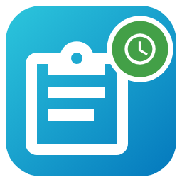
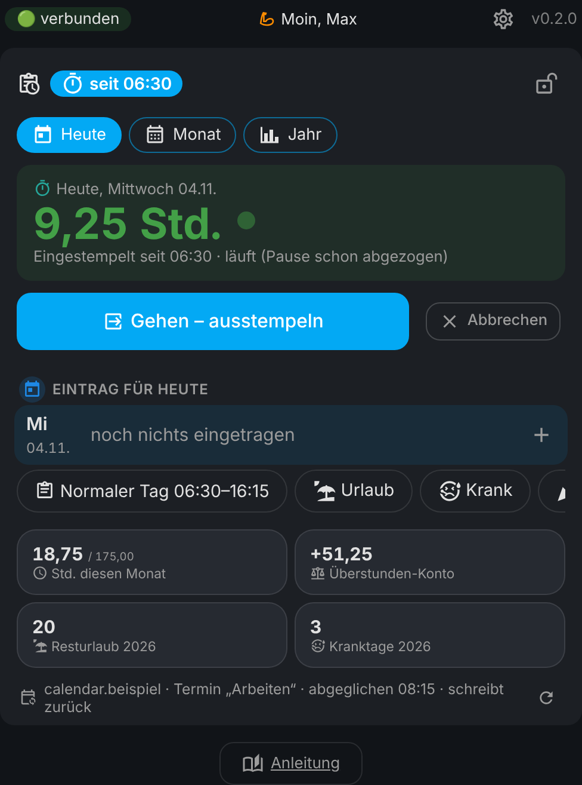

# ⏱️ Stundenzettel (timesheet) for Home Assistant

🇩🇪 **Deutsch?** → [README auf Deutsch](README.md)

**No more handwritten timesheets.** The card takes your working hours from your calendar (or you clock in by button, or automatically by phone zone), subtracts the break and keeps your **overtime balance** – just like the old paper sheet.

One click opens it right in your Home Assistant:  

> 🔒 **Your times stay with you.** Everything lives only in your Home Assistant. No cloud. This repo contains made-up example data only.

> 🧪 **Brand new (version 0.2).** The card speaks German and English (automatically like your Home Assistant, or `language: en`).

## ✨ Features

- ⏱️ Today at a glance: today's hours big at the top (running while clocked in), then hours this month and overtime balance.
- 📅 Reads a daily calendar event (default name „Arbeiten“) with start and end – every 15 minutes, including note and „(+0,50 h Pause)“.
- 📤 Optional: writes your times back to the calendar (Google: delete + create, because Home Assistant can't edit Google events). Missing events are created again; „write all days“ catches up on a whole period.
- ⏱️ Two fields „Kommen“/„Gehen“ (arrive/leave) under Today – tap, change the time, done. ⏱️ clocks in/out now, or automatically when your phone enters/leaves a zone. Rounding to 5 or 15 minutes.
- ⚖️ Overtime balance per month: total − paid hours = plus/minus, previous balance + plus/minus + correction = new balance. Current month counts the target only up to today. 💶 Enter the carried-over balance from your payslip each month – the card continues with your boss's number and shows the difference.
- 📊 Statistics: overtime curve, hours per month with target line, weekdays, vacation & sick per year, records – for one year or all years.
- 🏖️ Vacation, sick, holiday, day off, flat rate days. Vacation left and sick days per year.
- ☕ Break rules by duration or by the time you leave (e.g. until 12:00 → 0.25, later → 0.50), 💶 paid hours per month (with history like „until Dec 2019: 160“), corrections, 🎌 holidays from a holiday calendar.
- 📄 Compare your employer's timesheet: pick the „Zeitsaldenliste“ PDF in a month – where their hours differ they appear left of yours (green = employer has more, red = fewer), plus their balance; „Saldo Vormonat“ can be taken over as carried-over hours with one tap. Works only with this timesheet type (PDF from a computer, no photos).
- ⓘ Tap-help: small ⓘ next to the fields in ⚙️ instead of long texts.
- 📥 Import an old sheet by pasting text. From Google Sheets/Excel the monthly values come along too (total, carried over, balance, 8 hours and more), otherwise „set the balance“ to the value of the paper sheet.
- 📤 Print & share month or year as PDF (WhatsApp, mail, iPhone printing), print or as text, 📄 CSV, 💾 backup, 📜 log, 📌 sidebar.
- 📱 Offline app for your phone (⚙️ → App & info → Offline app): clock in and enter days without signal, sent later with the original time. Home-screen shortcuts „Kommen“/„Gehen“, fingerprint lock.
- 📅 Flip through days in Today: ‹ › at the top of the hours tile or swipe.
- 📝 Quick picker for notes: your places and activities as buttons (learned from your notes), each place on a new line.
- 🔒 PIN lock for ⚙️, for changes in the month and to older days (today and yesterday stay free) or the whole card (checked offline too, relocks after 10 minutes). Forgot it? Devices & services → Stundenzettel → Configure → Reset PIN.
- ⏰ Mascot: a little alarm clock with moods and seasonal costumes (off by default). 🙈 Veil overtime, ↩️ undo, 🧘 calm mode, hide tabs.

## 📦 Installation

Install via HACS (from Home Assistant 2026.11: Settings > Marketplace).

1. **HACS → ⋮ → Custom repositories** → `https://github.com/misterm2310/stundenzettel-card`, type **Integration**.
2. Download **Stundenzettel**, restart Home Assistant.
3. **Settings → Devices & services → Add integration → Stundenzettel**.
4. Add the card: `type: custom:stundenzettel-card` (options: `title`, `language: de|en`)

## 🤖 Automations

Sensors: `sensor.stundenzettel_ueberstunden`, `sensor.stundenzettel_stunden_diesen_monat`, `sensor.stundenzettel_resturlaub`, `sensor.stundenzettel_kranktage_dieses_jahr`, `binary_sensor.stundenzettel_eingestempelt`.
Actions: `stundenzettel.kommen` (clock in), `stundenzettel.gehen` (clock out), `stundenzettel.tag_eintragen` (record a day), `stundenzettel.abgleichen` (sync), `stundenzettel.daten_abrufen` (get data).

**⏳ When will the next beta come?** To be honest: I build these integrations with the help of Claude (AI). How fast new betas come depends on how much Claude quota (tokens) is available. Once it is used up, I have to wait until it is refilled – no tokens, no betas. 😅 Thank you for your patience and understanding! 🙏

## 💙 Donate

Free forever. If you like it: [paypal.me/MarcoStrickmann](https://paypal.me/MarcoStrickmann) ☕

Ideas → [Discussions](https://github.com/misterm2310/stundenzettel-card/discussions) · Bugs → [Issues](https://github.com/misterm2310/stundenzettel-card/issues) (please no real working times!)

License: MIT · by [Mister-M](https://github.com/misterm2310) · Icons: [Material Design Icons](https://pictogrammers.com) (Apache 2.0)
