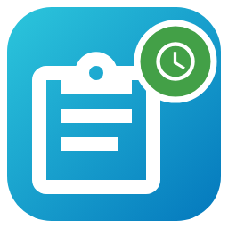
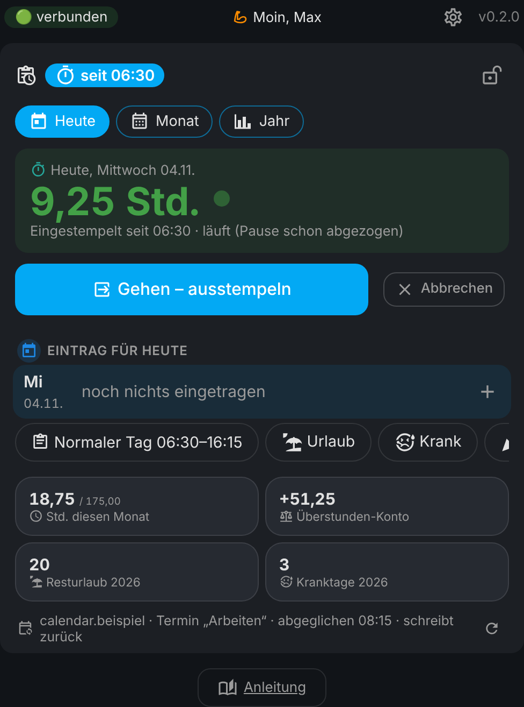

# ⏱️ Stundenzettel für Home Assistant

🇬🇧 **English?** → [README in English](README.en.md)

**Schluss mit dem Stundenzettel von Hand.** Die Karte holt sich deine Arbeitszeit aus dem Kalender (oder du stempelst per Knopf bzw. automatisch per Handy), zieht die Pause ab und führt dein **Überstunden-Konto** – genau wie der alte Papier-Zettel: Summe, Bezahlt, Ü.-Alt, Ü.-Gesamt.

Ein Klick öffnet es direkt in deinem Home Assistant: [](https://my.home-assistant.io/redirect/hacs_repository/?owner=misterm2310&repository=stundenzettel-card&category=integration) [](https://my.home-assistant.io/redirect/config_flow_start/?domain=stundenzettel)



> 🔒 **Deine Zeiten bleiben bei dir.** Alles liegt nur in deinem Home Assistant. Keine Cloud, kein fremder Server. In diesem Repo stehen nur ausgedachte Beispieldaten.

> 🧪 **Ganz neu (Version 0.2).** Läuft im Test, ist aber noch frisch – Rückmeldungen sind willkommen.

---

## ✨ Was kann das Ding?

- ⏱️ **Heute auf einen Blick**: oben groß die Stunden von heute (beim Stempeln läuft die Zeit mit), darunter Stunden im Monat und Überstunden-Konto.
- 📅 **Aus dem Kalender**: Termin „Arbeiten“ mit Anfang und Ende? Wird alle 15 Minuten übernommen – inklusive Notiz (z. B. Baustelle) und „(+0,50 h Pause)“.
- 📤 **Oder andersrum**: Die Karte ist die Chefin und schreibt deine Zeiten in den Termin. Krank oder Urlaub → der Arbeits-Termin verschwindet. Fehlt ein Termin, legt die Karte ihn wieder an; „Alle Tage in den Kalender schreiben“ holt ganze Zeiträume nach. (Google kann über Home Assistant nicht ändern – die Karte löscht dann und legt neu an.)
- ⏱️ **Kommen & Gehen** als zwei Felder oben unter Heute (antippen, Uhrzeit ändern, fertig), ⏱️ „jetzt“ zum Stempeln – oder **automatisch**, wenn dein Handy in die Zone „Arbeit“ kommt bzw. sie verlässt. Zeiten auf 5 oder 15 Minuten runden.
- ⚖️ **Überstunden-Konto** wie auf Papier: Summe − Bezahlt = Plus/Minus, Ü.-Alt + Plus/Minus = Ü.-Gesamt. Im laufenden Monat fair: **Soll nur bis heute**. 💶 **Ü.-Alt laut Lohnabrechnung** pro Monat eintragen – die Karte rechnet mit der Zahl vom Chef weiter und zeigt die Abweichung.
- 🏖️ **Urlaub, Krank, Feiertag, Frei, Pauschal** (z. B. Samstag für feste Euro – zählt nicht zu den Stunden). Resturlaub und Kranktage pro Jahr.
- ☕ **Pausen-Regeln** nach Dauer (Standard: mehr als 0 Std. → 0,25 · mehr als 6 Std. → 0,50) **oder nach Uhrzeit beim Gehen** (z. B. bis 12 Uhr 0,25 · danach 0,50) – einzelne Tage auch anders.
- 💶 **Bezahlte Stunden** pro Monat, **früher anders** (z. B. bis Dezember 2019: 160) und **Korrekturen** (ausgezahlt, geschenkt).
- 🎌 **Feiertage automatisch** aus einem Feiertags-Kalender (z. B. Integration „Feiertage“ für dein Bundesland).
- 🥪 **„8 Stunden und →“**: zählt die langen Tage (ohne Pause gerechnet).
- 📊 **Statistik**: Überstunden-Kurve, Stunden pro Monat mit Soll-Linie, Wochentage, Urlaub & Krank pro Jahr, Rekorde – für ein Jahr oder alle Jahre.
- 📄 **Zettel vom Chef vergleichen**: im Monat die „Zeitsaldenliste“ als PDF wählen – wo seine Stunden anders sind, stehen sie links neben deinen (grün = Chef hat mehr, rot = weniger), dazu sein Saldo. „Saldo Vormonat“ geht mit einem Tipp als Ü.-Alt rein. Geht nur mit diesem Zettel-Typ (PDF vom Computer, keine Fotos).
- ⓘ **Hilfe zum Antippen**: In ⚙️ steht neben den Feldern ein kleines ⓘ statt langer Texte.
- 📥 **Alten Zettel übernehmen**: einfach aus Google Tabellen/Excel/PDF kopieren und einfügen. Aus Tabellen kommen auch die **Monatswerte** mit (Summe, Ü.-Alt, Ü.-Gesamt, 8 Stunden und →) – jeder alte Monat sieht aus wie auf dem Zettel. Sonst **„Konto stellen“** auf den Stand vom Zettel.
- 📤 **Drucken & Teilen** für Monat und Jahr: als **PDF** (WhatsApp, Mail, iPhone-Druck), drucken oder als Text, 📄 **CSV**, 💾 **Sicherung**, 📜 **Verlauf**, 📌 **Seitenleiste**.
- 📱 **Offline-App** fürs Handy: stempeln und Tage eintragen auch **ohne Netz** (z. B. im Keller der Baustelle) – wird nachgeschickt, die Uhrzeit vom Knopfdruck bleibt. Kurzbefehle „Kommen“ und „Gehen“ am App-Symbol, Fingerabdruck-Sperre.
- 🔒 **PIN-Sperre** für ⚙️, fürs Ändern (ansehen geht frei) oder die ganze Karte – prüft auch ohne Netz, sperrt nach 10 Minuten wieder.
- 🌍 **Deutsch und Englisch** (automatisch wie dein Home Assistant).
- ⏰ **Maskottchen**: ein kleiner Wecker mit Laune und Jahreszeiten-Kostüm (Standard aus).
- 🙈 **Überstunden verschleiern**, ↩️ **Rückgängig** nach dem Löschen, 🧘 **Ruhiger Modus**, Reiter ausblenden.

---

## 📦 Installation

Installation über HACS (ab Home Assistant 2026.11: Einstellungen > Marketplace).

1. **HACS** öffnen, oben rechts **⋮ → Benutzerdefinierte Repositories**, `https://github.com/misterm2310/stundenzettel-card` eintragen, Typ **Integration**, **Hinzufügen**.
2. Nach **Stundenzettel** suchen, **Herunterladen**, danach **Home Assistant neu starten**.
3. **Einstellungen → Geräte & Dienste → Integration hinzufügen → Stundenzettel** → Absenden. 🎉
4. Dashboard → **Bearbeiten → Karte hinzufügen → Stundenzettel**.

```yaml
type: custom:stundenzettel-card
```

> 🙌 Eine Ressource musst du **nicht** von Hand eintragen, das macht die Integration selbst.

<details><summary>Optionen der Karte – <i>aufklappen</i></summary>

| Schlüssel | Standard | Was |
|---|---|---|
| `title` | `Stundenzettel` | Überschrift (nur wenn anders als „Stundenzettel“) |
| `language` | automatisch | `de` oder `en` – sonst wie dein Home Assistant |

Alles andere stellst du direkt in der Karte unter ⚙️ ein.
</details>

<details><summary>📱 Offline-App – <i>aufklappen</i></summary>

1. In der Karte ⚙️ → **App & Info → Offline-App** → Adresse kopieren (braucht eine **https**-Adresse, z. B. Nabu Casa).
2. Auf dem Handy im **Browser** öffnen (nicht in der HA-App), einmal mit deinem Home-Assistant-Benutzer anmelden.
3. Browser-Menü → **„Zum Startbildschirm hinzufügen“**. Fertig – eigenes Symbol.

Ohne Netz zeigt die App den letzten Stand. Stempeln und Tage eintragen landen im **Postausgang** („⏳ 1 wartet“) und gehen raus, sobald wieder Netz da ist. **Abmelden** löscht nur die Kopie im Handy, in Home Assistant bleibt alles.
</details>

<details><summary>🔒 PIN vergessen? – <i>aufklappen</i></summary>

Ein Admin geht auf **Einstellungen → Geräte & Dienste → Stundenzettel → Konfigurieren** und hakt **„PIN zurücksetzen“** an. Die PIN liegt nur als Prüfsumme in Home Assistant.
</details>

<details><summary>Ohne HACS (von Hand)</summary>

Den Ordner `custom_components/stundenzettel` nach `/config/custom_components/stundenzettel` kopieren und Home Assistant neu starten. Dann weiter mit Schritt 3.
</details>

---

## 👆 So wird's benutzt

<details><summary>Erster Start – <i>aufklappen</i></summary>

1. ⚙️ → **Kalender**: deinen Kalender wählen, in dem jeden Arbeitstag ein Termin **„Arbeiten“** steht (der Name ist einstellbar).
2. ⚙️ → **Bezahlte Stunden & Konto**: wie viele Stunden pro Monat bezahlt werden (Standard 175).
3. ⚙️ → **Normaler Tag**: deine üblichen Zeiten pro Wochentag (für den Knopf „📋 Normaler Tag“ und das Soll bis heute).
4. Optional: ⚙️ → **Stempeln per Handy** (Person + Zone) und ⚙️ → **Import** für den alten Zettel.

Alles Weitere steht in der Karte unter **📖 Anleitung** (mit Suche).
</details>

<details><summary>🧮 So wird gerechnet – <i>aufklappen</i></summary>

- Arbeitstag: (Ende − Anfang) − Pause. Beispiel: 6:30–16:15 = 9,75 Std. da → mehr als 6 → 0,50 Pause → **9,25 Std.**
- Urlaub, Krank, Feiertag: zählen je **8 Std.** (einstellbar). Frei = 0. Pauschal zählt gar nicht.
- Monat: **Summe − Bezahlt = Plus/Minus**. **Ü.-Alt + Plus/Minus + Korrektur = Ü.-Gesamt**. Steht beim Monat ein **Ü.-Alt laut Lohnabrechnung**, nimmt die Karte diese Zahl statt des eigenen Vormonats-Stands.
- Laufender Monat: Das Soll zählt nur für die Arbeitstage bis heute → **„Konto heute“**.
- Monate ganz ohne Einträge zählen nicht mit (sonst gäbe es für Lücken riesige Minusstunden).
- ✋ Was du in der Karte änderst, fasst der Kalender nie wieder an.
</details>

---

## 🤖 Für Automationen

<details><summary>Sensoren und Aktionen – <i>aufklappen</i></summary>

| Entität | Was |
|---|---|
| `sensor.stundenzettel_ueberstunden` | Überstunden-Konto heute (Attribut: Stand Vormonat) |
| `sensor.stundenzettel_stunden_diesen_monat` | Stunden im laufenden Monat (Attribut: bezahlt) |
| `sensor.stundenzettel_resturlaub` | Resturlaub dieses Jahr (Attribut: genommen) |
| `sensor.stundenzettel_kranktage_dieses_jahr` | Kranktage dieses Jahr |
| `binary_sensor.stundenzettel_eingestempelt` | an, solange du eingestempelt bist |

Aktionen: `stundenzettel.kommen`, `stundenzettel.gehen`, `stundenzettel.tag_eintragen` (Datum, Art, von, bis, Pause, Notiz …), `stundenzettel.abgleichen`, `stundenzettel.daten_abrufen` (gibt Konto und Monate als Antwort zurück).

Beispiel: Erinnerung, wenn du um 18 Uhr noch eingestempelt bist.

```yaml
alias: Stundenzettel – Ausstempeln vergessen?
description: Erinnert um 18 Uhr, wenn du noch eingestempelt bist.
triggers:
  - trigger: time
    at: "18:00:00"
conditions:
  - condition: state
    entity_id: input_boolean.schalter_wartung
    state: "off"
  - condition: state
    entity_id: binary_sensor.stundenzettel_eingestempelt
    state: "on"
actions:
  - action: notify.notify
    continue_on_error: true
    data:
      message: "⏱️ Du bist noch eingestempelt – Feierabend vergessen?"
```

</details>

---

## 💙 Gefällt dir der Stundenzettel?

Er ist und bleibt **kostenlos**. Wenn du magst, kannst du mir ganz freiwillig eine kleine Spende per PayPal schicken: [paypal.me/MarcoStrickmann](https://paypal.me/MarcoStrickmann). Den Link gibt es auch unter ⚙️ → Credits. Der Feierabend-Kaffee geht auf dich. ☕

[](https://paypal.me/MarcoStrickmann)

---

## 💡 Ideen, Wünsche und Fehler

- **Idee oder Wunsch?** Schreib sie bei den [Diskussionen](https://github.com/misterm2310/stundenzettel-card/discussions).
- **Etwas funktioniert nicht?** Mach ein [Issue](https://github.com/misterm2310/stundenzettel-card/issues) auf, mit deiner Version (oben rechts in der Karte). **Bitte keine echten Arbeitszeiten mitschicken!**

---

## 🧪 Für Entwickler

<details><summary>Tests – <i>aufklappen</i></summary>

```bash
pip install -r requirements_test.txt
pytest
```

Dazu ein **Oberflächen-Test** im Browser (alle Reiter, Tag bearbeiten, alle Einstellungen, Anleitung, PIN, ohne Netz, Englisch, Maskottchen) mit ausgedachten Daten: `cd tests/ui && npm install && npx playwright install chromium && node ui.test.mjs`. Die Beispieldaten baut `python tests/ui/make_demo.py`.

</details>

Lizenz: MIT · von [Mister-M](https://github.com/misterm2310) · Symbole: [Material Design Icons](https://pictogrammers.com) (Apache 2.0)
